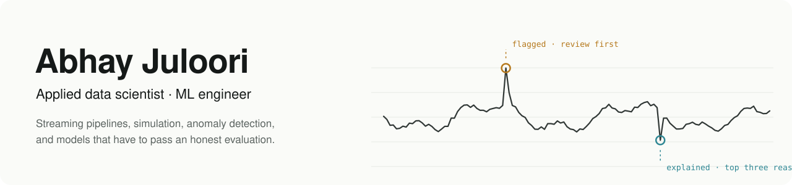

<picture>
  <source media="(prefers-color-scheme: dark)" srcset="assets/banner-dark.svg">
  
</picture>

I build ML and data systems end to end: the pipeline, the model, the evaluation that decides whether it ships, and the interface someone uses to act on it. When a more complex model doesn't beat the simple one, the simple one ships and the result stays on the record.

- **Research Data Scientist, Procter & Gamble** (2025 to 2026). Surrogate models for an expensive packaging-engineering process, with confidence deciding when to trust the shortcut and when to escalate.
- **Data Engineer & Scientist, Taiyo.AI** (2023 to 2024). Airflow pipelines landing 30+ web and API sources in an S3 data lake for live client analytics.
- **MEng Computer Science**, University of Cincinnati.
- Open to **data scientist, ML engineer and applied scientist** roles.

## Selected work

| Project | The question | What the evidence says |
|---|---|---|
| [**Graph-Aware Fraud Detection**](https://github.com/AbhayJuloori/graph-aware-fraud-detection) · [page](https://abhayjuloori.github.io/graph-aware-fraud-detection/) | Do transaction-graph features earn their complexity? | No. +0.0004 PR-AUC on a disjoint confirmation cohort failed the promotion gate, so the transaction-only XGBoost shipped: MLflow registry, FastAPI with TreeSHAP reasons, Evidently drift reports. |
| [**Keystroke and Mouse Anomaly Detection**](https://github.com/AbhayJuloori/keystroke-mouse-anomaly) · [page](https://abhayjuloori.github.io/keystroke-mouse-anomaly/) | Is the person typing the person who usually does? | Per-user models on the CMU and Balabit benchmarks with a time split. Isolation Forest reached mean EER 0.086 across 51 users; mouse scoring reached AUC 0.93. One explained 0 to 100 session risk score, served with a per-user PSI drift check. |
| [**Warehouse Fulfillment Digital Twin**](https://github.com/AbhayJuloori/warehouse-fulfillment-digital-twin) · [page](https://abhayjuloori.github.io/warehouse-fulfillment-digital-twin/) | What is the cheapest crew that still keeps a two-hour delivery promise? | SimPy shift simulation plus Optuna search: the same SLA on 22% less labor, confirmed on 24 seeds the search never saw. |
| [**WikiPulse**](https://github.com/AbhayJuloori/wikipulse) · [live](https://abhayjuloori.github.io/wikipulse/) | Which live Wikipedia edits should a patroller check first? | Kafka, Spark Structured Streaming and Iceberg, idempotent under replays and late data. The in-browser port of the scoring logic is checked against 1,500+ real captured edits. |
| [**Freight KPI Tracker**](https://github.com/AbhayJuloori/freight-kpi-tracker) · [page](https://abhayjuloori.github.io/work/freight-kpi-tracker/) | Which shipments cost too much or ran late, and why? | Leakage-safe cost baselines, detectors chosen on calibration data only, then a held-out quarter: 98.3% precision and 100% recall on 12,500 synthetic invoices, with a ranked review queue. |
| [**Catanator**](https://github.com/AbhayJuloori/catanator) | Can a search bot play competitive two-player Catan? | Rust engine 114x faster than the Python reference with zero divergences over 654,627 plies, a whole-turn planner, and a self-play-tuned evaluation. Strong against bots in simulation; the open problems are tracked as issues. |

**Also:** [Stats Reasoning Eval](https://github.com/AbhayJuloori/stats-reasoning-eval) (which open models catch leakage, peeking and Simpson's paradox, and how far to trust the judge) · [CareTarget](https://github.com/AbhayJuloori/hospital-readmission-targeting) (uplift modelling for readmission outreach) · [LoanSurv](https://github.com/AbhayJuloori/loansurv) (time-to-default with Cox PH and survival forests) · [Credit Recourse Engine](https://github.com/AbhayJuloori/credit-recourse-engine) (conformal prediction and counterfactual actions) · [Controlled Document Retrieval](https://github.com/AbhayJuloori/controlled-document-retrieval-compliance-tracking-system) (version- and jurisdiction-aware retrieval with an audit log)

## Open source

Fixes found while using these libraries on real work, each with regression tests.

| Repository | Contribution | Status |
|---|---|---|
| [unit8co/darts](https://github.com/unit8co/darts) | [#3243](https://github.com/unit8co/darts/pull/3243) NegativeBinomialLikelihood returned parameters in the wrong order for multivariate series | Merged |
| [unit8co/darts](https://github.com/unit8co/darts) | [#3244](https://github.com/unit8co/darts/pull/3244) Six single-parameter likelihoods trained on only the first sample of each batch | Merged |
| [unit8co/darts](https://github.com/unit8co/darts) | [#3246](https://github.com/unit8co/darts/pull/3246) ONNX inference failed for integer-indexed series | Merged |
| [unit8co/darts](https://github.com/unit8co/darts) | [#3245](https://github.com/unit8co/darts/pull/3245) ZeroInflatedLikelihood for series with excess zeros | In review |
| [sebp/scikit-survival](https://github.com/sebp/scikit-survival) | [#654](https://github.com/sebp/scikit-survival/pull/654) Cumulative incidence with `time_min`, cross-checked against R `survival` | In review |

## How I work

- Start from the decision, not the benchmark.
- Freeze the evaluation before reading the result. Keep negative results.
- Ship the model with something people use: an API, a dashboard, or a workflow.

## Toolbox

